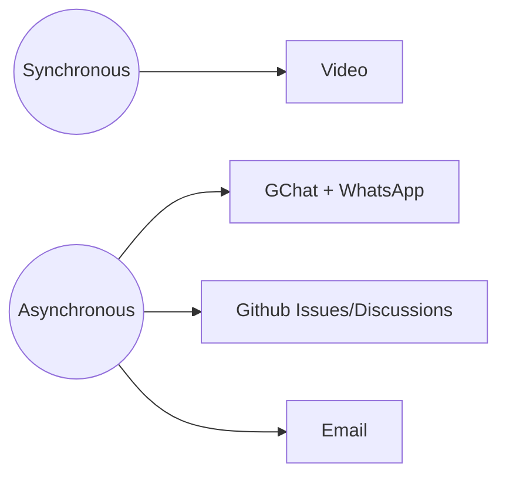

# Onboarding Guide

Welcome to Life Itself! 👣 🌱

This guide provides you with a simple step-by-step process to get set up at Life Itself so that you are ready to go. We have designed it to be largely self-service so you can do it on your own, at your own pace.

> [!tip] Feedback 📣
> 
> We value feedback 😄 You can make this handbook better by making amendments directly using the edit link at the bottom of each page (please check in with your Onboarder first). Or you can leave comments using Hypothesis (see below).

## Onboardee Journey Overview

Your onboarding journey will consist of the following steps in order. Each stage will be covered in more depth further on in the guide.

1. [Prerequisites](#prerequisites)
2. [Set up your computer (with AI)](#set-up-your-computer-with-ai)
3. Welcome Call - this will be set up by person onboarding you 😄
4. [First Steps](#first-steps)
5. [How we Communicate](#how-we-communicate)
6. [[further-reading|Further Reading]]
7. [Getting Help and Finding Stuff](#getting-help-and-finding-stuff)

## Prerequisites 

Before we get to the proper onboarding there are some essential prerequisites to get yourself set up.

Please complete as many of the following steps as you can on or before your Welcome Call so we can make sure you have access to all systems. 

If you get stuck please contact your onboarder and let them know. 

1. **Life Itself email**: Login in to your Life Itself email account and check it. You should have received an invitation to your personal email with details of how to sign in to your Life Itself email account and set your password. Sign in and check your account for any email you may have already received.
2. **Key systems**: Setup your accounts on the key systems we use. **Do this before the next step!** When you set up systems, try to pick usernames that will be easy for others to remember. Using your first and last name is ideal.
   * Gravatar -- https://gravatar.com. **Do this FIRST so your Gravatar is used on the other accounts you create.** To be able to create a Gravatar, you have to create a WordPress account first. You can then create a Gravatar so that your profile picture will show up automatically on your profile on other systems. 
     * When you create your Gravatar, add your Life Itself email and *all* the email(s) you will use on other accounts. [If you get stuck, you can read more about Gravatar here](https://wordpress.com/support/gravatars/)
   * GitHub -- https://github.com. This may seem a bit geeky but bear with us 😉 At Life Itself we use GitHub for a variety of things from collaborating on projects to deploying our website.
3. **Message your onboarder**: with your Github username so they can get you added and you have access for the following steps.
4. **Set up your AI**: we default to Claude. Install the Claude desktop app (https://claude.ai/download) and sign in with your Life Itself email. You'll use its Code tab in the [next step](#set-up-your-computer-with-ai).

These additional items can be done out of order and at any time (even before you have your email etc)

- **Background on working with us:** Read about [[working-with-us|Working with Us]] and [[getting-stuff-done|Getting Stuff Done]]
- **Laptop setup**: we recommend installing the following (on MacOS at least)
  - Browser: ChatGPT Atlas (or Chrome)
- **Markdown**: read the [Markdown tutorial](https://datopian.com/playbook/markdown/) -- Markdown is a markup language with plain text formatting syntax. We often use Markdown based tools.
  - (Optional) [Obsidian](https://obsidian.md) for markdown editing and knowledgebase management

## Set up your computer (with AI)

This gets your computer ready to work with us: git, GitHub access, and Beads, our task tracker, with the team's planning repo on your machine. Claude does the work. You only sign in and paste a key when it asks.

Do this once you are in the `life-itself` GitHub organisation (prerequisite 3) and have Claude installed (prerequisite 4). Open the Code tab in the Claude desktop app and paste this:

```
I'm joining the Life Itself team. Set up this computer so I can work with you in the life-itself GitHub organisation: git, SSH access to GitHub, the GitHub CLI (`gh`), and Beads (`bd`, our task tracker), with the life-itself/planning repo cloned to ~/code/life-itself/planning.

Do it for me. Check what's already there, run the commands yourself, and pick sensible defaults for my machine (Mac or Windows). Only stop when I have to act myself: signing in, pasting a key into github.com, typing my computer password. Never ask me for a password or token in chat. Get my name and email from my GitHub account once I'm signed in; ask only if something is missing.

Key points:
- SSH key: no passphrase. If GitHub shows "Configure SSO" next to the key, have me authorise life-itself. Check GitHub's host key against its published fingerprints before accepting it.
- Beads: install the latest official release (github.com/gastownhall/beads), without admin rights if needed. In the planning repo, run `bd bootstrap`, never `bd init`.
- Set BEADS_ACTOR permanently to my team ID: my lowercase first name unless I say otherwise.

If something fails, work out why before changing anything. When done, read planning's README and AGENTS.md, give me a five-line summary of how the team works, and list what works and anything left for me to do.
```

Stuck? Paste the error into Claude and ask it to work out what's wrong. Still stuck, message your onboarder.

## First Steps

### GitHub

✋ It's fine if you are unfamiliar with GitHub -- you only need the basics for now. 🙂

We use GitHub https://github.com/ for a lot of project management as well as managing some of our websites. We want to introduce you to it here briefly because we will use its issue tracker functionality.

The issue tracker is space for storing and sharing task lists - you can think of it as an online notebook full of to-do lists. You can create an issue within the issue tracker to outline all the subtasks associated with something you're working on. Updating the issue records your progress and keeps your team up-to-date.


### Create an Onboarding Issue

You are going to track your onboarding progress using a GitHub issue in the onboarding project. **You will not be able to create issues if you have not been added to the relevant systems. Finish the [prerequisites](#prerequisites) first.**

* Please go to: https://github.com/life-itself/onboarding/issues
* Create your own issue and use it to track your Onboarding progress. Name it like `Onboarding {First Name} {Last Name} {Date}`
* Copy and paste the checklist below into your issue and modify it/add more learnings to it while going through the Onboarding process (eg. Markdown, GitHub, etc.).

```md
This is my exciting onboarding issue! 🌱

## Onboarding Essentials

### Prerequisites

* [ ] I have access to Life Itself email
* [ ] I have set up accounts on all the systems
* [ ] I have set up my laptop

### First Steps

* [ ] Have created this issue in GitHub 😄
* [ ] I have access to GDrive
  * [ ] Have created my Email signature 
  * [ ] Doc Styles are set. Test by creating a google doc and checking that default doc styles are automatically applied (you can delete this document afterwards).
* [ ] Calendar
  * [ ] [settings] Add working hours
  * [ ] [settings] Check if your time zone is correct
  * [ ] Created a calendar meeting
  * [ ] Invited one or more other people to it
  * [ ] Deleted it
  * [ ] Add any days to your and the team calendar in next 2 months in which you will be away (delete these afterwards if inaccurate).
* [ ] Meetings - read about meeting best practices
* [ ] Standups
  * [ ] Read about standups
  * [ ] Wrote a standup as a comment in this github issue
* [ ] Update this issue following the issue and tasks instructions
* [ ] Computer set up with AI (git, GitHub, Beads): see [computer setup](#set-up-your-computer-with-ai)
  * [ ] Asked for your `people/<id>.md` record in the planning repo (it fixes your ID, usually your lowercase first name, and records your GitHub username in `github:`)
  
### Extra Steps

* [ ] Read about how to create a perfect issue in GitHub: [[issues|Issues and Tasks]]
* Read about getting things done
  * [ ] Playbook: https://datopian.com/playbook/getting-things-done/
  * [ ] Rufus' write up (maybe just read the summary for now): https://rufuspollock.com/2019/05/27/getting-things-done/
* [ ] Read about SCQH: https://issuetrees.com/
* [ ] *Really* read about [job stories](http://datopian.com/playbook/job-stories/) (and user stories)
  * [ ] 📝 Summarize in your own words with examples why "so that" is so important 
* [ ] 📝 At end: notify your onboarder if you made comments (using hypothesis or otherwise) and put link to your comment stream e.g. https://hypothes.is/users/rufuspollock so that they can quickly find all your comments. 
```

### Google Drive

After setting up your email address, you will have access to **GSuite**, and of course, [Google Drive](https://drive.google.com/drive/).

The Onboarder will have granted you access to relevant Team Drives. Initially, you should have access to **All Team - Life Itself**, **Finance & Operations - Life Itself**, **Raw Content Store** and **Second Renaissance** in the Shared Drives. This will allow you to access and store the information / documents you require.

* Any new documents / sheets / presentations you create should be created in the appropriate folder in the Team Drive, **not your personal drive**. This speaks to our open and collaborative working culture and avoids having to explicitly share files with people.
* If you require access to files that you currently don't have access to, please reach out to your Onboarder.

#### Create your E-mail signature

Please implement this [E-mail signature template](https://docs.google.com/document/d/15asO0IVqAyUJrv0RHT6IkXAD3-kiUfN0mOj9LSqJH1c/edit?usp=sharing) into your gmail account. To do this, go to 'all settings' in Gmail and scroll down to update your email signature.

#### Install default styles

We use default styles for Life Itself so that our documents look neat and coherent. Follow the steps below to set up default styles for your documents in Drive.

* Go into [Doc Style Template](https://docs.google.com/document/d/1f_k9PSY44CXi39Pm9jKBmXdjsD1N0PpjPVtqE-HHhb4/edit#) 
* Then, click the menu item *Format → Paragraph Styles → Options → SAVE as my default styles*

Test it:

* Create a new document
* Start writing.
* Check the styles are correct: compare with the styles in the template.

### Calendar

It is expected that you keep your calendar up to date, so that if it shows as free, that means a colleague can add a meeting during that period.

#### Set Your Working Hours

Set your working hours in the Google Calendar settings so that people automatically get warned when they try to schedule a meeting outside of your working hours.

For instructions on how to set your working hours, see:

https://support.google.com/calendar/answer/7638168?hl=en

Working hours are according to the primary time zone you have set in Google Calendar.
For info on where to find your primary time zone in the settings, see:

* https://support.google.com/calendar/answer/37064?hl=en&co=GENIE.Platform=Desktop

#### View your teammates' calendars

* To see someone else's calendar, see others' calendars side by side or find a time that someone is free, see: https://support.google.com/calendar/answer/6294878
* You can also add the calendars of the teammates you're mostly working with so you can easily see their availability. For instructions, see https://support.google.com/calendar/answer/37100

## How We Communicate

### Communication

*As a virtual organization we need to have efficient, reliable, cost-effective ways to communicate and share material.*



#### Chat

We use GChat (Google Chat) for team discussions and Whatsapp more for community messages of which there is no need to keep a record. We use Github issues and discussions, and secondarily email, for longer messages and messages that someone may want to refer back to. You'll be added to relevant groups as part of your onboarding.

#### Voice / Video calls

Our default tools for video are Google Hangouts and Zoom. We add a video call link to every meeting set up in Google calendar.

> [!tip]
> 
> Face to face communication is a big deal for humans. Facial cues are very important. Always prefer video over voice for synchronous.

#### Email

We use Gmail.

#### Documents

We use markdown documents in Github or Google Drive for all internal documents.

### Meetings

Make sure to familiarise yourself with our [[meetings|patterns for meetings]]. 

### Markdown

Markdown is a markup language with plain text formatting syntax. We often use Markdown based tools, including GitHub.

If you are new to Markdown, see the [Markdown tutorial](https://playbook.datopian.com/markdown/)

### Passwords and Logins

Passwords and logins for common services can be found in a private location. Check with your onboarder for access.

### Standups

Read https://tao.rufuspollock.com/Standups

### Issues and Tasks

What we are working on lives in [Planning](https://planning.lifeitself.org): initiatives, projects, people, weekly plans and the task board. [Our office](https://planning.lifeitself.org/guides/our-office) shows how it fits with the other repos.

Read [[issues|Issues and Tasks]] and apply it (see checklist in onboarding issue)

#### Your Beads identity

We track tasks in Beads (see the [Beads guide](https://planning.lifeitself.org/guides/beads); [computer setup](#set-up-your-computer-with-ai) installs it). Tasks are assigned by person ID, not by GitHub or git name, so do this in order:

1. Make sure you have a record in the planning repo's `people/` (ask if not). The filename is your ID, usually your lowercase first name, and the `github:` field links it to your GitHub username, which can differ.
2. Add `export BEADS_ACTOR=<your-id>` to `~/.zshenv` and open a new terminal.
3. Check: `echo $BEADS_ACTOR` prints your ID.

If Beads says `cannot close … assignee is "X", actor is "Y"`, the names don't match: fix `BEADS_ACTOR`, don't use `--force`. Details: [Beads assignee conventions](https://github.com/life-itself/planning/blob/main/docs/bd-task-conventions.md#setting-your-identity).

---

## Further Reading

We recommend you look at the reading below as part of your onboarding:

* [[working-with-us|Working with Us]]
* [[getting-stuff-done|Getting Stuff Done]]
* [[working-with-ai|How we work (with AI)]]: how we organise shared work and use AI to do it, as a reading path
* You can also have a quick look around https://lifeitself.org/ - bonus points for comments on what works and what could be improved!

## Getting Help and Finding Stuff

We're fully remote so our equivalents of all the standard office chatting takes place either in Whatsapp 💬  or on video calls. 📺

If you need help, just message anyone directly and they'll be happy to help -- we are a friendly bunch. 🤗
